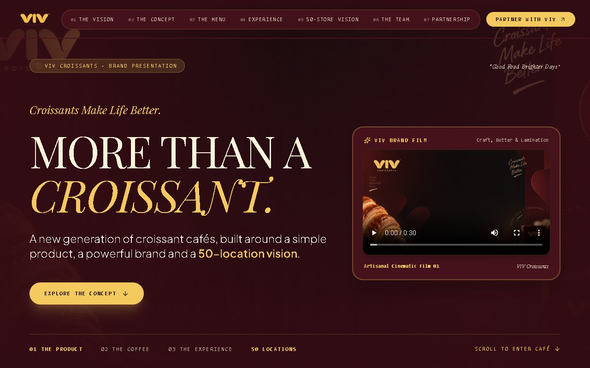

# VIV Croissants × ProMedia — Interactive F&B Brand Growth & Digital Pitch Deck



🌐 **Live Presentation:** [viv-digital-presentation.vercel.app](https://viv-digital-presentation.vercel.app/)  
🏢 **Agency Partner:** **ProMedia**  
👨‍💻 **Digital Engineering & Execution:** [Mostafa Mohamed Farhat (Elshorbagy)](https://mostafa-portfolio-iota.vercel.app/)

---

## Overview

An interactive F&B brand growth, visual menu showcase, and creator marketing pitch deck developed for **VIV Croissants** in partnership with **ProMedia**.

### Key Features
- **Brand & Product Showcase:** High-impact presentation of VIV Croissants' official brand identity, menu photography, and positioning.
- **F&B Production & Creator Proof:** Integrates case studies and food-creator collaborations (*5 Roosters*, *El Zuzzat*, *Blue View*).
- **Commercial Growth Roadmap:** Structured digital marketing, short-form video production, and influencer activation strategy.

---

## Tech Stack
- **Framework:** React + TypeScript + Vite
- **Styling:** Tailwind CSS
- **Deployment:** Vercel

---

## Local Development

```bash
npm install
npm run dev
npm run build
```
